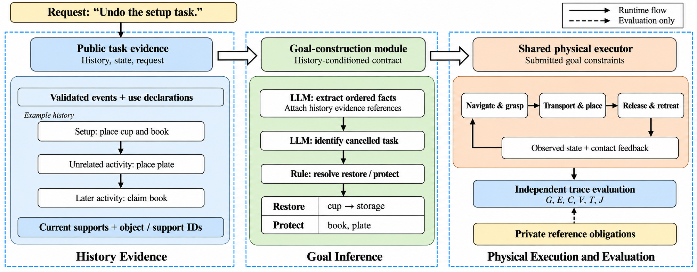

# Architecture

The system has three stages: assemble public history, infer a goal, and execute
that goal through physical actions. Independent reference labels reach only
the offline evaluator.



The architecture image was produced with the built-in image-generation tool
and reviewed against the implemented flow. It illustrates the system, not a
new physical experiment.

## Read the code in this order

| Layer | Start here | Responsibility |
| --- | --- | --- |
| Task semantics | [`domain/policies.py`](../src/task_undo/domain/policies.py) | Select obligations from structured public history |
| Goal contract | [`domain/undo_contract.py`](../src/task_undo/domain/undo_contract.py) | Validate complete restore/protect goals and choose the next action |
| Language | [`agents/narrative_controlled.py`](../src/task_undo/agents/narrative_controlled.py) | Direct and facts + rule readouts |
| Orchestration | [`application/goal_execution.py`](../src/task_undo/application/goal_execution.py) | Run the same observed-state executor for different goal sources |
| Physics | [`simulation/session.py`](../src/task_undo/simulation/session.py) | Observe the world and dispatch ordinary actions |
| Evaluation | [`evaluation/scoring.py`](../src/task_undo/evaluation/scoring.py) | Score recorded states and grasp traces against private labels |
| Joint metrics | [`evaluation/end_to_end.py`](../src/task_undo/evaluation/end_to_end.py) | Keep goal, execution, task and joint success separate |

The execution contract has two fields:

```json
{"restore": {"cup": "storage_surface"}, "protect": ["book", "plate"]}
```

Every registered object must appear exactly once. Protection is relative to
the undo-start state, while restoration uses the support before the cancelled
task began.

The executor monitors its submitted contract. It does not look up the reference
goal or repair an incorrect model goal. The evaluator can therefore distinguish
successful execution of a wrong goal from successful task-scoped undo.

Simulator imports are delayed until a worker starts. The CPU demonstration,
model client, contract logic and most offline checks use only the standard
library. The physical backend and optional geometry utilities have separate
dependencies.
